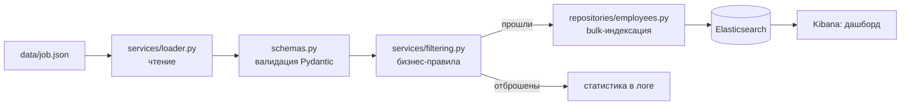

# HR-аналитика с использованием Elasticsearch

[](https://www.python.org/)
[](https://github.com/armatveeeva/hr-analytics-elastic/actions)
[](LICENSE)
[](https://www.elastic.co/elasticsearch/)
[](https://www.elastic.co/kibana/)

Репозиторий содержит пайплайн обработки, фильтрации и визуализации HR-данных с применением Elasticsearch и Kibana.

Данный этап работы реализует скрипт загрузки данных, их первичную фильтрацию по строгим бизнес-критериям и подготовку инфраструктуры (маппинг и спецификацию дашборда) для последующей аналитики. Результаты индексируются в Elasticsearch и визуализируются в дашборде Kibana.

## Описание предметной области

Пайплайн охватывает процесс загрузки HR-данных, их строгую фильтрацию и индексацию в поисковый движок. Система спроектирована для обеспечения быстрого поиска и агрегации данных, что создаёт основу для:
- Визуализации ключевых HR-метрик в интерактивных дашбордах Kibana.
- Анализа распределения сотрудников по заданным параметрам.
- Масштабирования аналитики на большие объёмы данных в реальном времени.

**Ключевые критерии фильтрации данных:**
- Сотрудники с зарплатой от 50 000 до 200 000 рублей;
- Рост сотрудников строго больше 160 см.

## Архитектура



1. **Загрузка** (`services/loader.py`): читает JSON-файл и передаёт каждую запись на валидацию.
2. **Валидация** (`schemas.py`): Pydantic отбрасывает некорректные записи (возраст, пол, пустые поля).
3. **Фильтрация** (`services/filtering.py`): применяет бизнес-правила, пороги задаются через `HR_SALARY_MIN`, `HR_SALARY_MAX`, `HR_HEIGHT_MIN_EXCLUSIVE`.
4. **Индексация** (`repositories/employees.py`): создаёт индекс по `config/index_mapping.json` и загружает документы пачкой (bulk).
5. **Визуализация**: дашборд в Kibana собирается по спецификации [docs/dashboard.md](docs/dashboard.md).

## Структура проекта

| Путь | Назначение |
|---|---|
| `src/hr_analytics/cli.py` | Команды `create-index` и `load` |
| `src/hr_analytics/config.py` | Настройки из переменных окружения `HR_*` |
| `src/hr_analytics/schemas.py` | Модель записи и валидация (Pydantic) |
| `src/hr_analytics/services/` | Загрузка (`loader.py`) и бизнес-правила (`filtering.py`) |
| `src/hr_analytics/repositories/` | Клиент и работа с индексом Elasticsearch |
| `config/index_mapping.json` | Маппинг индекса |
| `data/job.json` | Пример входных данных |
| `docs/dashboard.md` | Спецификация дашборда Kibana |
| `tests/` | Unit-тесты |

## Технологический стек

- **Язык:** Python 3.11+
- **Зависимости:** Poetry (`pyproject.toml`)
- **Валидация и настройки:** Pydantic v2, pydantic-settings
- **Хранилище и поиск:** Elasticsearch 8.x (`elasticsearch-py`), Kibana 8.x
- **Качество кода:** Ruff, mypy (strict), pytest, pre-commit, GitHub Actions
- **Инфраструктура:** Docker Compose

## Быстрый старт

Нужны: Python 3.11+, Poetry, Docker (Compose v2), make.

```bash
git clone https://github.com/armatveeeva/hr-analytics-elastic.git
cd hr-analytics-elastic
cp .env.example .env
make install        # зависимости и pre-commit
make up             # Elasticsearch + Kibana (Kibana: http://localhost:5601)
make create-index   # индекс по маппингу
make load           # загрузка и фильтрация data/job.json
```

После `make load` в логе появится сводка: всего записей, невалидных, отфильтрованных и проиндексированных.

Запуск целиком в Docker, без локального Python:

```bash
docker compose up -d --wait
docker compose --profile app run --rm app create-index
docker compose --profile app run --rm app load
```

## Команды

| Команда | Что делает |
|---|---|
| `make install` | Установка зависимостей и хуков pre-commit |
| `make up` / `make down` | Запуск и остановка Elasticsearch и Kibana |
| `make create-index` | Создание индекса по маппингу |
| `make load` | Загрузка, валидация и фильтрация данных |
| `make lint` / `make format` | Ruff: проверка и форматирование |
| `make typecheck` | mypy (strict) |
| `make test` | pytest с покрытием |

## Конфигурация

Переменные окружения с префиксом `HR_` (шаблон в `.env.example`):

| Переменная | Назначение | По умолчанию |
|---|---|---|
| `HR_ES_URL` | Адрес Elasticsearch | `http://localhost:9200` |
| `HR_ES_API_KEY` | API-ключ (приоритетнее логина и пароля) | не задан |
| `HR_ES_USER`, `HR_ES_PASSWORD` | Basic Auth | не заданы |
| `HR_ES_VERIFY_CERTS` | Проверка TLS-сертификатов | `true` |
| `HR_INDEX_NAME` | Имя индекса | `workers_matveeva` |
| `HR_MAPPING_PATH`, `HR_DATA_PATH` | Пути к маппингу и данным | `config/index_mapping.json`, `data/job.json` |
| `HR_SALARY_MIN`, `HR_SALARY_MAX` | Границы зарплаты | `50000`, `200000` |
| `HR_HEIGHT_MIN_EXCLUSIVE` | Рост строго больше | `160` |
| `HR_LOG_LEVEL` | Уровень логирования | `INFO` |
