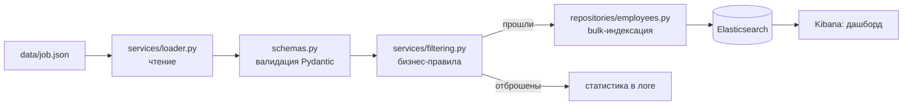

# HR-аналитика с использованием Elasticsearch

[](https://github.com/armatveeeva/hr-analytics-elastic/actions)
[](https://www.python.org/)
[](LICENSE)
[](https://www.elastic.co/elasticsearch/)
[](https://www.elastic.co/kibana/)

Репозиторий содержит пайплайн обработки, фильтрации и визуализации HR-данных с применением Elasticsearch и Kibana.
Данный этап работы реализует скрипт загрузки данных, их первичную фильтрацию по строгим бизнес-критериям и подготовку инфраструктуры (маппинг и спецификацию дашборда) для последующей аналитики. Результаты индексируются в Elasticsearch и визуализируются в дашборде Kibana.

## Описание предметной области

Пайплайн охватывает процесс загрузки HR-данных, их строгую фильтрацию и индексацию в поисковый движок. Система спроектирована для обеспечения быстрого поиска и агрегации данных, что создаёт основу для:
- Визуализации ключевых HR-метрик в интерактивных дашбордах Kibana.
- Анализа распределения сотрудников по заданным параметрам.
- Масштабирования аналитики на большие объёмы данных в реальном времени.

**Ключевые критерии фильтрации данных:**
- Сотрудники с зарплатой от 50 000 до 200 000 рублей;
- Рост сотрудников строго больше 160 см.

## Структура проекта

Информационный пайплайн построен на модульной архитектуре и включает следующие компоненты:

| Компонент | Описание | Назначение |
|-----------|----------|------------|
| `index_mapping.json` | Конфигурация маппинга | Задание типов полей (например, `salary` как `float`, `height` как `integer`) и параметров анализа в Elasticsearch |
| `loader.py` | Скрипт обработки данных | Чтение исходного датасета, применение бизнес-правил фильтрации и bulk-индексация в кластер |
| `dashboard.md` | Спецификация Kibana | Описание используемых визуализаций, запросов (KQL) и layout дашборда |
| `.env.example` | Шаблон окружения | Конфигурация параметров подключения к хостам Elasticsearch и Kibana |

## Технологический стек

- **Язык программирования:** Python 3.11+
- **Клиент базы данных:** `elasticsearch-py`
- **Хранилище и поиск:** Elasticsearch 8.x
- **Система визуализации:** Kibana 8.x
- **Управление конфигурацией:** `python-dotenv`

## Архитектура



## Быстрый старт

1. Клонируйте репозиторий:
```bash
git clone https://github.com/armatveeeva/hr-analytics-elastic.git
cd hr-analytics-elastic
cp .env.example .env
make install        # зависимости и pre-commit
make up             # Elasticsearch + Kibana (Kibana: http://localhost:5601)
make create-index   # индекс по маппингу
make load           # загрузка и фильтрация data/job.json
```
